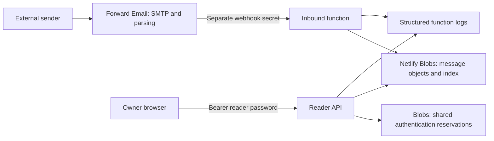

# Security and operational boundaries

Evolve Inbox is a receiving mailbox for one owner. The public demonstration has fictional messages and no mailbox API calls. It is not an email sending service, identity provider, or multi-user mail platform.

## Trust boundaries

- Forward Email authenticates to the inbound endpoint with `MAIL_HOOK_SECRET`. SPF, DKIM and DMARC badges display the provider's reported results; they are not independently verified here.
- The owner authenticates to the reader API with a separate `MAIL_PASSWORD`. Keep both random and private. Passwords are stored in server environment settings and in the owner's tab session storage, not in the static demo.
- Only Netlify's handler `context.ip` selects the authentication bucket. User-supplied forwarding headers are ignored. Another adapter must supply a trusted context; requests without it share the fallback bucket.
- Message bodies, subjects and attachments are untrusted. HTML opens in a sandbox with remote images and scripts blocked. Attachments are not scanned for malware.
- Hosting and forwarding accounts can access mail. Messages are not end-to-end encrypted. A compromised account or reader password can expose and delete mail. There is no MFA, account separation, or recovery service.

## Shared authentication reservations

Before comparing a reader credential, the API reserves one of 20 slots for 60 seconds using strongly consistent Blobs reads and conditional writes. Failed authentication retains the slot. Successful authentication releases it by ETag; a delayed release cannot overwrite a newer reservation. Crashes leave a slot occupied until expiry. Each slot is its own conditional object: there is no shared mutable counter or in-memory limiter.

The trusted IP is HMAC-mapped into 256 fixed buckets. No raw IP, credential, or HMAC is persisted. There are at most 5,120 reservation objects, reused after expiry without growing a time-series of keys. The HMAC key is the configured webhook secret, falling back to the reader password for incomplete setups. Changing it remaps buckets.

Buckets can collide, and clients behind the same NAT share a budget. Twenty failed attempts can temporarily lock out a legitimate owner in that bucket. Successful requests usually reuse a released slot, but more than 20 simultaneous requests can also be throttled. HTTP 429 includes `Retry-After` and `Cache-Control: no-store`; wait before retrying. This is a small-mailbox safeguard, not protection from a botnet, provider resource exhaustion, or all denial-of-service attacks. Use provider perimeter controls for hostile traffic. Each authenticated request adds storage reads/writes; review usage at your expected volume.

Authentication storage failures return 503 without comparing credentials or returning mail. This intentionally favors confidentiality over reader availability. Valid inbound deliveries do not use reader reservations, so a reader lockout does not stop incoming mail. The inbound secret is a high-entropy capability; inbound request floods still require provider controls.

Conditional writes must have provider-enforced ETags. Tests reject missing versions and unconfirmed writes. The [Netlify Blobs API](https://docs.netlify.com/build/data-and-storage/netlify-blobs/) documents these conditions; [Functions context](https://docs.netlify.com/build/functions/api/#ip) supplies the trusted IP. In-memory tests exercise interleavings, not the provider's production consistency guarantees.

## Rotate credentials

No live credential changes are made by setup, doctor or rotation commands.

1. In a trusted local clone with the current private `.env`, run `npm run rotate`. It creates `.env.rotation` with mode 0600 and refuses to overwrite a previous file. The active `.env` is untouched. Store the new values in your password manager. The generated file includes old credentials and a one-hour UTC deadline.
2. Review the correct Netlify site, production context and Functions scope. Import the staged settings and redeploy. The deadline must still be in the future when deploying. A previous credential requires a valid UTC deadline no more than 24 hours ahead; malformed, expired or missing deadlines fail closed. To revoke immediately, remove both `*_PREVIOUS` and `*_PREVIOUS_UNTIL` settings and redeploy. When responding to compromise, revoke instead of retaining the exposed credential for grace.
3. Unlock a new reader tab with the new `MAIL_PASSWORD`. Update the private Forward Email alias to `/mail/hook/NEW_MAIL_HOOK_SECRET?raw=false`. For DNS-based routing, encrypt the complete new rule before publishing. Never publish either secret in plaintext DNS. The old webhook remains usable only through the grace deadline while routing is switched.
4. Run doctor using the new settings. Send a real message from a separate account and verify delivery. Doctor only checks DNS and read-only API access; it cannot verify the forwarding destination or SMTP path.
5. Before the deadline, verify both new credentials work. Then remove the previous settings, redeploy, and verify the old reader returns 401 and old webhook returns 404. An exhausted reader bucket may return 429 first; wait for its `Retry-After`. Keep provider retries in mind when ending webhook grace. Update your private active `.env`, then securely remove the staged file and old password-manager values.

Setting a previous secret equal to either credential of the other role is rejected. Current secrets must also be independent; doctor and authenticated readiness report this misconfiguration. Existing browser tabs need the new password after the grace period. Rotation is a manual operational procedure, not an automatic deployment or guaranteed zero-downtime migration.

## Audit events

`evolve-inbox.audit.v1` events contain exactly `schema`, UTC `at`, `event`, and `surface` (`reader` or `inbound`). Events cover rejected or throttled authentication, previous-credential use, accepted deliveries, deletion, and unavailable storage. They never include request objects, URLs, IPs, tokens, message IDs, addresses, subjects, content, attachments, or exception text. Normal successful reads are not logged.

The default sink emits JSON to function logs. These events are best effort: a broken sink does not interrupt mail delivery or change authentication results. They are not an immutable audit ledger or evidence of exactly-once delivery. Provider access-log metadata is separate; because the inbound capability is in a URL path, restrict access-log access and review provider redaction and retention. Configure log retention/export and access restrictions in the hosting account; no separate audit database is created.

## Evidence and remaining limits

- [Security tests](../test/security.test.mjs): shared budget across handler instances, concurrent guesses, expiry, header spoofing, failed storage, delayed release, rotation deadlines, role isolation and audit privacy.
- [Inbox tests](../test/inbox.test.mjs): authentication, concurrent deliveries/deletion, idempotent retries, interrupted saves, malformed payloads, restrictive rendering headers and legacy message compatibility.
- [Client tests](../test/client.test.mjs) and [type checks](../test/client-types.mts): safe headers, no redirects/retries, typed errors, cancellation and TypeScript imports.
- [CLI tests](../test/cli.test.mjs): private file modes, refusal to overwrite, JSON output, staged rotation and no printed credentials.

Messages and the index are separate objects, not a transaction. The index lists at most 2,000 messages; older bodies have no automated retention policy. Provider retries can repair a body saved before an interrupted index update. Matching Message-ID, content and recipients deduplicate retries; messages without an ID cannot reliably be deduplicated. Deletion failures can leave partial state and require an operator retry. Backups, recovery testing, malware scanning, outbound mail and MFA remain outside this release.
