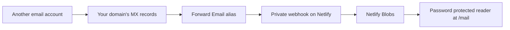

# Set up your own inbox

You need a domain whose DNS you control, a Netlify project connected to your fork, and Forward Email routing for the addresses you want to receive. Node 22 or later is required for the local tools. Provider plans and usage limits apply; this repository does not create accounts or buy services.

Mail follows this path:



## 1. Create your deployment

Fork the repository and connect your fork to a Netlify project, or use the [Deploy to Netlify button](https://app.netlify.com/start/deploy?repository=https://github.com/anthony-firn/evolve-inbox). The repository includes the build and function configuration. Keep the production site URL; a custom website domain is optional and can differ from the email domain.

The root page `/` is a fictional, read-only demo. Your actual inbox is at `/mail`. Uploading only the `public/` directory will not deploy the mail function.

## 2. Generate your private settings

In a local clone of your fork:

```sh
npm ci
npm run setup -- --domain example.com --site https://your-inbox.netlify.app --label "My Inbox"
```

Replace the example domain and site URL with yours. Running `npm run setup` in an interactive terminal also prompts for them. The command creates two files with owner-only permissions:

- `.env` contains independently generated reader and webhook secrets, the inbox label, domain and site URL.
- `.mail-setup.md` contains your exact webhook URL, forwarding rule, MX records and verification steps.

Both files are ignored by Git. Secrets are not printed to the terminal. Save your reader password in a password manager. The command refuses to overwrite existing files; edit existing settings intentionally rather than regenerating credentials on every run.

The default instructions route only `hello@example.com`. Choose another address with `--alias support`. To receive every address on the domain, explicitly use `--alias '*'`; catch-all routing also receives more unwanted mail.

For manual setup, copy `.env.example` to `.env` and generate each secret independently with a password manager or `node -e "console.log(require('node:crypto').randomBytes(32).toString('hex'))"`.

| Setting | Purpose | Required |
| --- | --- | --- |
| `MAIL_PASSWORD` | Password for the reader and authenticated API | Yes |
| `MAIL_HOOK_SECRET` | Separate secret in the inbound webhook URL | Yes |
| `MAIL_LABEL` | Inbox name in the reader | No; defaults to Evolve Inbox |
| `MAIL_DOMAIN` | Domain shown in setup guidance and checked by the doctor | For the doctor |
| `MAIL_SITE_URL` | Stable HTTPS origin checked by the doctor | For the doctor; local use only |

## 3. Add settings to Netlify and redeploy

Use Netlify's environment settings to import `.env`. Enable the **Functions** scope for the secrets, label and domain; plans that require all scopes can use all scopes. Set secrets in the **production** context. Review the import before saving. Restrict access to the hosting project because its members can access stored mail.

The [Netlify CLI](https://cli.netlify.com/commands/env/) can also import the file after you log in and link the correct project:

```sh
netlify link
netlify env:import .env
```

Review scopes and deploy contexts in the Netlify dashboard after importing, then redeploy. `.env` is not included in your Git-based deployment automatically. Open `/mail` and unlock with `MAIL_PASSWORD`. The authenticated **Setup status** button checks storage access and whether an independent inbound secret is configured.

Deploy previews should not receive production secrets. Netlify's site-wide `mail` store is shared across deployments of the same project, so use a separate Netlify project for development that needs storage. See [Netlify's storage documentation](https://docs.netlify.com/build/data-and-storage/netlify-blobs/).

## 4. Configure Forward Email

Add your email domain to Forward Email and verify it using its [setup instructions](https://forwardemail.net/en/faq). In its account dashboard, create a private alias with the webhook URL from `.mail-setup.md` as its destination. Keep `?raw=false` in the URL so the provider sends parsed content without a raw MIME copy. Keep attachments enabled.

If you configure aliases through DNS, use Forward Email's [TXT encryption tool](https://forwardemail.net/en/encrypt) to encrypt the **complete** forwarding rule from your private guide. Publish only the encrypted result as the root TXT record. A plaintext webhook URL reveals the delivery secret to anyone querying DNS. Never publish `MAIL_PASSWORD` in DNS.

For manual setup, the destination format is:

```text
https://YOUR-SITE.netlify.app/mail/hook/YOUR_MAIL_HOOK_SECRET?raw=false
```

Review existing aliases and MX records before moving a live domain. When ready, route inbound mail through both Forward Email MX hosts:

| Type | Host | Priority | Value |
| --- | --- | --- | --- |
| MX | @ | 10 | mx1.forwardemail.net |
| MX | @ | 10 | mx2.forwardemail.net |

Configure routing in the Forward Email dashboard or through an encrypted DNS rule, as appropriate for your plan. Follow the provider's domain-verification instructions. Do not remove or replace existing SPF, DKIM or DMARC records just to enable this receiving app. Sending mail has separate authentication requirements.

## 5. Check the deployment, then send real mail

```sh
npm run doctor
```

The doctor reads `.env` and checks:

- The domain, HTTPS site URL and independent local secrets.
- Both receiving MX hosts and any competing MX hosts.
- Root TXT records for plaintext webhook URLs or exposed inbox secrets, without printing their values.
- Rejection of unauthenticated API access.
- Authenticated storage reads, inbound-secret configuration, the deployed domain, message count and latest receipt time.

It exits with a nonzero code if a check fails. DNS failures, unreachable deployments and incorrect passwords include a next step. The command makes read-only requests, follows no redirects, and never posts a synthetic message. It cannot prove that an alias points to the correct webhook secret or that SMTP delivery works.

Send a real message from another account to your chosen alias. Check that it arrives in `/mail`, that its recipient is correct, and that you can read its text, formatted content and attachments. Run the doctor again to see the latest receipt. Sender badges report the provider's checks; they are not a guarantee that a message is safe.

## Troubleshooting

| Symptom | Check |
| --- | --- |
| `/` shows example messages | Open `/mail` for your private inbox. |
| `/mail` or `/mail/api/status` returns 404 | Deploy the repository with its function, rather than uploading only the static demo. |
| Password rejected | Check `MAIL_PASSWORD` in Netlify, its Functions scope and production context, then redeploy. |
| Setup status says inbound is not ready | Set `MAIL_HOOK_SECRET` to a different random value from `MAIL_PASSWORD` and redeploy. |
| Storage check returns 503 | Review the function deployment, Netlify Blobs access and hosting limits. Retry after resolving the storage failure. |
| No mail after the checks pass | Check the alias destination, exact webhook secret, MX propagation and Forward Email delivery errors; send from a separate account. |
| Webhook returns 400 or 415 | Use parsed JSON with `Content-Type: application/json` and `raw=false`; this app does not accept raw MIME. |
| Webhook returns 413 | The entire JSON payload exceeds 5,000,000 bytes, including attachments. Byte-array JSON can be much larger than the original file. Hosting limits also apply. |
| Webhook returns 503 | Storage or index updates could not be confirmed. Keep provider retries enabled; retries with the same Message-ID and content reuse the stored message. |
| A webhook secret was published | Remove the public value, rotate `MAIL_HOOK_SECRET` in Netlify, redeploy, and update the private alias or encrypted rule. Rotate the reader password too if it was exposed. |

## Sending and replying

This app receives and reads mail. It does not implement sending, replies, drafts, SMTP submission, IMAP or POP3. Use a separately configured mail client/provider to send from your domain. If you choose Forward Email for outbound mail, follow its [SMTP setup guide](https://forwardemail.net/en/faq#do-you-support-sending-email-with-smtp) and configure the provider's required SPF, DKIM and DMARC records. Keep outbound credentials separate from both inbox secrets.

## Existing installations

Deploy the updated code with your existing secrets. Existing `msg/<id>` objects and the `index` array remain readable without migration. Set `MAIL_LABEL` and `MAIL_DOMAIN` if you want custom branding and domain guidance. To use the doctor, create a private `.env` with your existing settings plus `MAIL_SITE_URL`; do not generate replacement secrets unless you intend to rotate them.

Updates to the shared index now use conditional writes and bounded retries. If they cannot complete, the webhook returns 503. For messages with a Message-ID, retries with matching content and recipients reuse the first stored copy and repair a missing index entry after an interrupted save. Messages without a Message-ID cannot be reliably deduplicated. Retries of messages already saved by an older version may create a new copy. Storage writes span multiple objects and are not a transaction; this remains a small single-owner inbox rather than a high-volume mail platform.
